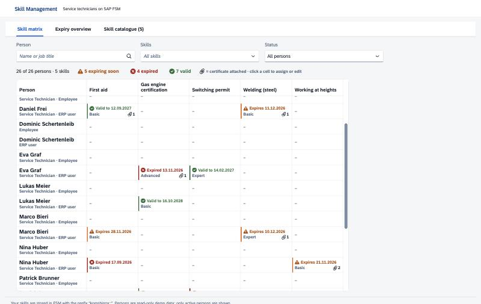
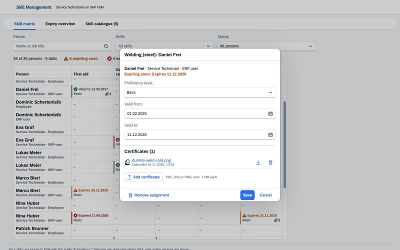
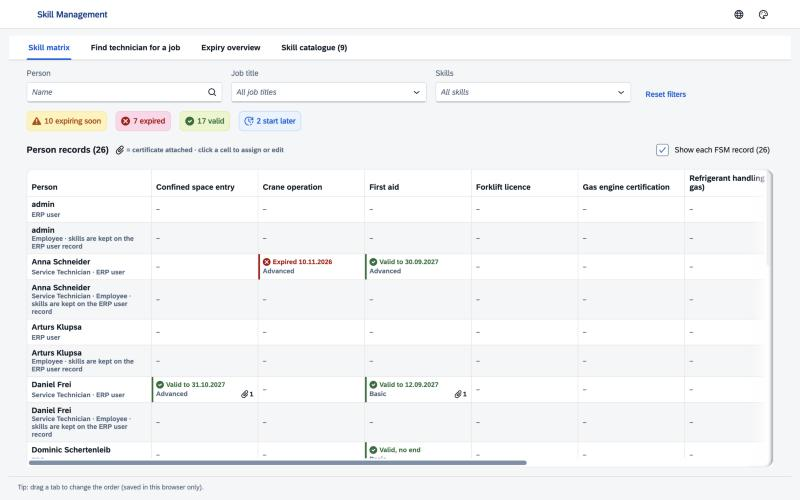
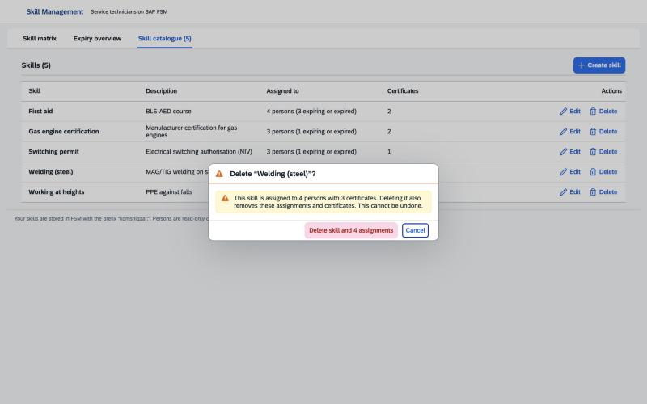

# Skill Management on SAP FSM

[](https://github.com/komshiqza/opusm-assessment/actions/workflows/ci.yml)

A web app for a service manager: which technician has which skill, at which level, backed by which certificate, valid until when. All data lives in SAP Field Service Management (the shared assessment company). The app has no database of its own.

Candidate namespace: `komshiqza::`



## Run it

As in the template's quick start: Node.js 22 or newer, `npm install`, `cp .env.example .env.local` (set `NEXT_PUBLIC_CANDIDATE_ID=komshiqza`, leave the FSM values as they are), `npm run check:fsm`, `npm run dev`.

One script was added: `npm test` runs 441 unit tests with [Vitest](https://vitest.dev/), against a fake FSM, so no FSM connection is needed. GitHub Actions runs typecheck, lint, the tests and the build on every push to `main`, without any secrets.

## What the app does

Four tabs. The app opens on "Find technician for a job", the shortest path to the right person for a job. The tabs can be reordered by dragging; the order is saved in the user's browser.

- **Skill matrix** (required). One row per real person, the skills as columns. Each cell shows the status as icon and text (valid, expiring within 30 days, expired, starts later, not assigned), the end date, the level and the number of certificates. Filters: person name, skills and job title. The coloured status counters above the table ("10 expiring soon", "7 expired", …) are the status filter: one click shows only those people, a second click shows everyone again. The header row and the name column stay in place when the table scrolls down or sideways. "Show each FSM record (26)" switches to one row per FSM Person record, so the matrix can also be seen with 25+ rows (see "Who is a row"). On desktop each skill column keeps a readable width, about five side by side, and the rest scroll sideways; tablets keep narrower columns; on a phone the matrix becomes one card per person.
- **Assign skills** (required). Clicking a cell opens the assignment dialog: assign, set level and validity, upload certificates in the same step, view, download or delete them, remove the assignment. "Valid to" before "valid from" blocks saving.
- **Skill catalogue** (required). Create, rename and delete skills, with counts of assignments and certificates per skill.
- **Find technician for a job** (extra). The brief's own risk is a technician sent to a job with an expired certificate. The manager picks the skills a job needs, optionally a minimum level, and the date. The app lists who has all of them valid on that day, and who is "almost" there, with the reason, for example "Welding (steel): Advanced, Expert needed". It uses only data already loaded: no extra FSM calls.
- **Expiry overview** (optional). Everything that ends within a chosen period (30, 60, 90, 180 or 365 days; 30 by default), soonest first, with or without what has already expired.
- **All skills of one person** (optional). Click a name. Without the edit action this view is read-only, so a technician self-service view could reuse it as is.
- **One skill to several persons** (optional). "Bulk assign", up to 25 persons, each checked like a single assignment; the result is listed per person.
- **Export CSV** (optional). Exactly what the matrix shows, ready for Excel in Switzerland (umlauts, semicolons, dd.mm.yyyy, no formulas).
- **Certificate preview** (optional). PDFs and images open inside the app.
- **English and German, light and dark, tablet and phone** (optional).

Not done: a separate technician self-service view.



## Design decisions

### Which FSM API for what

| Task | API | Why |
|---|---|---|
| Persons | Query API | Active UnifiedPerson rows (one per real person) and their Person records, matched by `refId`. |
| Skills (Tags) and their levels | Skill Service | Which levels a skill has (its scale: Basic, Advanced, Expert) exists only in the Skill Service. |
| Assignments (Skills) | Skill Service | The proficiency level exists only here. One search returns all assignments with their level. |
| Certificates: list | Query API | One query for all assignments at once (100 ids per query), not one call per cell. |
| Certificates: upload, download, delete | Data API | The only API that handles files. |
| Checks before a write | Skill Service, Data API | They show new data at once; the Query API shows it 1 to 3 seconds later. |

Opening the app costs 7 requests in this company. The number never grows per person or per cell: only by one page for every 1,000 rows of a list, and by one certificate query for every 100 assignments. After each change the app reloads the same 7, so the screen always shows what FSM really stored. That matters in a company where other people write too.

### Who is a row

In FSM one person can have up to three Person records (ERP user, Employee, Sales employee). SAP combines them into one [UnifiedPerson](https://help.sap.com/docs/SAP_FIELD_SERVICE_MANAGEMENT/fsm_data_model/person-unifiedperson.html), and the one key SAP guarantees across them is `refId`. So the app shows the active UnifiedPerson rows (13 in this company: 10 service technicians, Dominic, Arturs and `admin`) and maps every skill to its person by `refId`. A skill on a secondary record shows in the person's cell with "on Employee record". New skills always go to the person's main record, read fresh from FSM, so one person's skills are never split or duplicated. The Job title filter narrows the rows by trade. The matrix opens with "Service Technician" selected, so the manager first sees the technicians; any other choice is saved in the user's browser.

"Show each FSM record" lists every Person record instead: 26 rows in this company, each labelled "ERP user" or "Employee". Switching it on sets the Job title filter aside, so no record is hidden; switching it off brings the filter back. Only the main record's row can be edited. A linked record's row is read-only ("skills are kept on the ERP user record"), because new skills never go there.



### Status and dates

- Valid: no end date, or an end date more than 30 days away. Expiring soon: end date within the next 30 days. Expired: end date before today. Starts later: a start date after today (grey, not valid yet).
- The end date is the last valid day, so a skill that ends today is still valid today.
- An empty "valid from" means today, because the Skill Service refuses a skill without a start date, although the brief calls both dates optional. The field says so. An empty "valid to" means no end date.
- The matrix and "Find technician" use the same rule, so they cannot disagree.

### Proficiency level

Three buttons: Basic, Advanced, Expert. All skills in the app use one scale (this list of levels), `komshiqza::Proficiency`, created automatically with the first skill. Saving only new dates never changes the level.

### Certificates

PDF, JPG and PNG, at most 5 MB per file. The browser checks size and the real file type from the file's first bytes, and the server checks the same again, so a program renamed to `cert.pdf` is refused. FSM sends files as downloads, so the app loads the file itself and shows it inside the app.

### Deleting a skill that is still assigned

FSM refuses to delete a skill that is still assigned. I decided the app deletes it together with its assignments, after a clear warning: "This skill is assigned to 3 persons with 1 certificate. Deleting it also removes these assignments and certificates." After confirming, it deletes the certificates, then the assignments, then the skill: a certificate belongs to an assignment and an assignment to a skill, so the smallest parts go first and nothing is left without its owner. If a step fails, it stops and says exactly what was already deleted, because deletions in FSM cannot be undone.

Blocking the delete would force a manager who retires a skill to remove every assignment by hand. The risk of deleting is losing certificate evidence, which is why the warning names the numbers first.



### Safety in the shared company

The rule "change only what is yours" is checked twice.

- **On the server**, for every write, even when someone calls `/api/fsm/...` directly and never opens the app. Only the eight kinds of write the app makes are allowed. The target is read fresh from FSM and must belong to `komshiqza::`. A write may contain only the fields the app itself sends. If FSM cannot be asked, the write is refused. The template's write allowlist is unchanged; the check is one added call after it.
- **In the browser**, with the same rules, so the user gets a clear message at once.
- **On every read**, other candidates' data is filtered out.

The test data in FSM: 9 skills, 36 assignments and 18 dummy certificates, all `komshiqza::`, without personal data.

Tests run the real server route against a fake FSM: writes to a demo skill, to another candidate's skill, to an unknown entity or with a malformed id are all refused and never reach FSM.

### When FSM does not answer

Every request ends after 60 seconds. When an upload or a new assignment gets no answer, FSM may still have saved it. So the app checks FSM once and says "uploaded", "not uploaded, try again" or "couldn't confirm, check again". It never sends a write twice by itself.

### The matrix is a plain table

A matrix needs both the header row and the name column to stay in place. UI5's `Table` can keep only the header in place. `AnalyticalTable` has a plugin for fixed columns, but SAP marks it experimental, so the main screen does not use it. The matrix is a plain table in SAP's own theme colours, with UI5 components inside the cells; the other screens use the UI5 `Table`.

### State and structure

All FSM data is loaded and held in one hook (`src/hooks/useSkillData.ts`), without an extra library, because the data is small and "reload after every change" is easy to follow. Components never call FSM directly: they call the repository, which returns the app's own models.

```
src/
  app/                    page and the template's FSM proxy (one call added, see Safety)
  components/             one folder per screen (matrix, assignment, catalog, expiry, findTechnician, person, bulk) plus shared parts
  hooks/useSkillData.ts   loads all data, reloads after changes
  lib/domain/             status, dates, file rules, persons, job matching (pure functions, tested)
  lib/fsm/                template client, browser write guard, server write check
  lib/skills/             FSM reads and writes, certificates, bulk, the fake FSM for tests
  lib/i18n/               English and German texts
```

## Limitations and open issues

- Two people editing at the same time: the last save wins.
- A write that FSM saves only after the app's check can still end up twice. The app checks again before every retry, which leaves only a narrow gap; closing it fully would need FSM to recognise repeated writes.
- Files are checked by size and real type, not scanned for viruses. A real product would add a virus scanner on the server.
- The catalogue counts assignments of inactive persons, which the matrix does not show.
- English and German only.

## With more time

- **A warning period per skill**, for example 90 days for welding, because those courses are booked months ahead. In FSM this would be a user-defined field on the skill.
- **Connect "Find technician" to real FSM jobs.** The manager describes the job in words, AI suggests the skills, the manager confirms them, and the app suggests who can go. The assignment then goes through FSM's own planning, because availability and travel matter as much as skills.
- **AI reads an uploaded certificate**, suggests the dates and warns when the name does not match the technician.
- **A local AI model for both**, running on the customer's or OPUSm's own servers. Job descriptions and certificates hold customer and personal data; with a local model they never leave that infrastructure, which keeps them under Swiss nFADP and GDPR control without an outside AI provider. Not built now: the shared company forbids files with personal data, so it could not be tested honestly.
- **Phone**: install the app as a Progressive Web App and photograph a paper certificate straight into the assignment.

### From assessment to product

OPUSm builds extensions for many customers. Already independent of this company's data: skills come from the customer's catalogue, trades from the job titles in FSM, people from SAP's UnifiedPerson. For a large customer (not measured, because the shared company does not allow load tests) the matrix would draw only the visible rows, show skills by group or team instead of 150 columns, and reload only what changed.

## How I built it

I am an AI-assisted product builder, and I built this app the way I build my own products: I write clear requirements, Claude Code and Codex implement and explain the code.

- **My part:** I read the brief and the FSM guide, started from the manager's real question and decided what to build and how it should work, set the rules for the shared company, directed and followed the work step by step and tested every flow in the browser. Each technical decision was explained to me with its trade-offs before I agreed to it or changed it. For example, I asked that when FSM does not answer, the app checks by the file's fingerprint whether the certificate arrived, so a retry does not upload it twice.
- **Claude Code** (Anthropic, Opus) wrote the code and the tests, tried the FSM APIs and measured FSM's behaviour.
- **OpenAI Codex** reviewed the code independently after each larger change, several times as an adversarial security review of the server check.

My workflow: a plan before any code, a test for every bug fix, and nothing counts as done until a run proves it. Two extra audits checked the code and this README against each other. One example of what they found: an upload that finished during a delete left an orphaned file. Each finding was fixed with a test or is listed under "Limitations".

Flows tested by hand: create, rename and delete a skill (unassigned and assigned); assign with and without dates and with several certificates; "valid to" before "valid from"; change level and dates; upload PDF, JPG and PNG, a file over 5 MB, a `.docx` and a renamed file; open, download and delete a certificate; all filters and counters; the person view; Bulk assign; CSV in Excel; English and German; light and dark; tab order; Find technician with and without a minimum level; Expiry overview; 1440, 1024 and 768 px and a phone.
